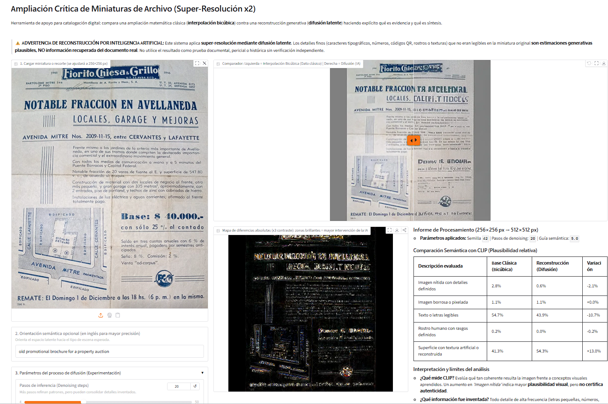
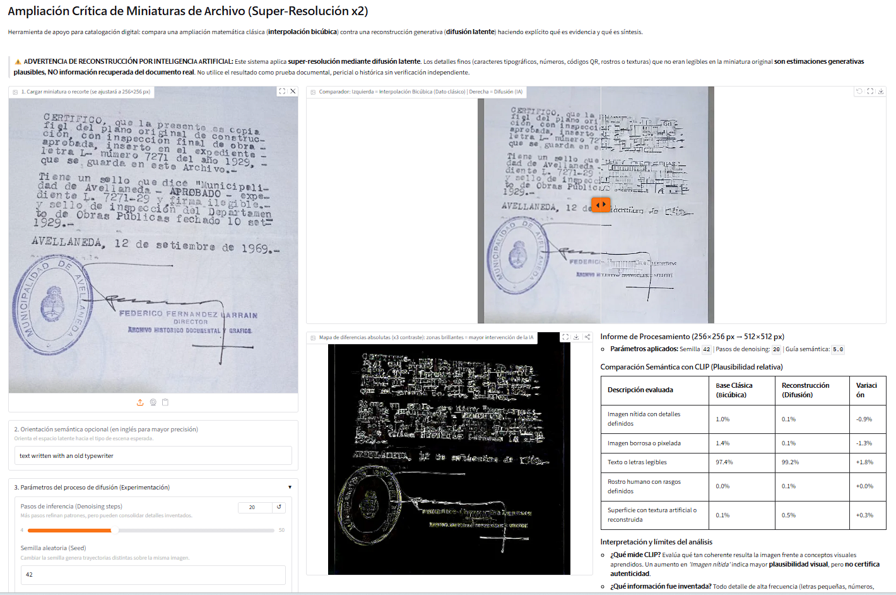
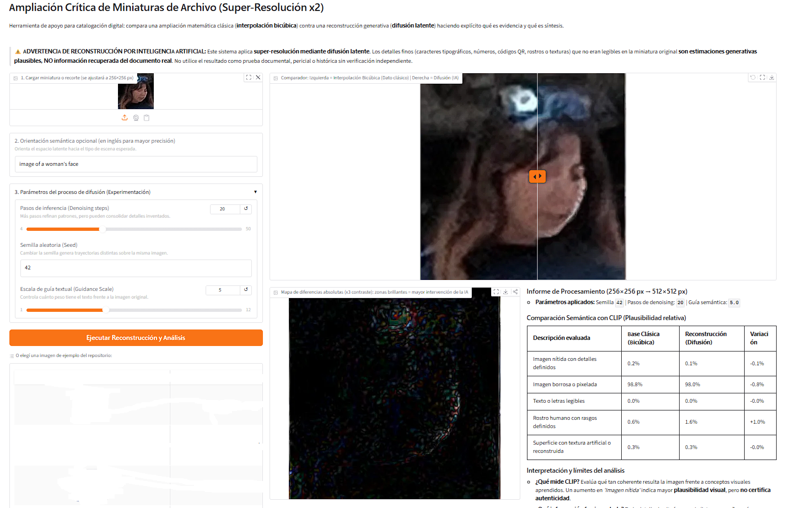

# Ampliación Crítica de Miniaturas de Archivo (Super-Resolución x2)

> Herramienta de apoyo para catalogación digital y archivística que compara una ampliación matemática clásica (**interpolación bicúbica**) contra una reconstrucción generativa (**difusión latente**), haciendo explícito qué información proviene del documento original y qué detalles fueron sintetizados por la IA.

> **Trabajo Integrador 2 — Procesamiento Digital de Imágenes (IFTS 24 - 2026)**
>
> - **Autor:** Barrionuevo Jose
> - **Profesor:** Barreto Matias
> - **Repositorio:** https://github.com/bjoseo/MVP-TPI-2
> - **Video Demo :** https://drive.google.com/file/d/1UU0um-urf0OJAubSO6IxWUvh8S3DZhaj/view?usp=sharing

---

## 1. Problema, Caso de Uso y Persona Usuaria

### Contexto y Problema

En tareas de digitalización de archivos históricos, inventarios patrimoniales o documentación urbana, con frecuencia se dispone únicamente de miniaturas o recortes de muy baja resolución (por ejemplo, detalles lejanos de cartelería, folletos o fotografías de época). Al intentar ampliar estas imágenes mediante modelos generativos de super-resolución, surge un riesgo crítico: **el modelo sintetiza detalles plausibles (letras, números, códigos o rasgos faciales) que no existían en los píxeles originales**, pudiendo inducir a errores de catalogación o falsas atribuciones documentales.

### Persona Usuaria

- **Nombre:** Martín (42 años)
- **Ocupación:** Catalogador y técnico en digitalización de archivo histórico municipal y barrial (Avellaneda).
- **Contexto tecnológico:** Maneja PC de escritorio con Windows, planillas y software básico de escaneo, pero no programa ni posee conocimientos profundos sobre redes neuronales o espacio latente.
- **Problema actual:** Recibe lotes de fotografías antiguas, folletos de época, actas mecanografiadas y carátulas de planos escaneados en baja resolución donde los encabezados o detalles secundarios se ven pixelados.
- **Frustraciones:** Las herramientas automáticas de "mejora con IA" deforman números de expediente, inventan letras inexistentes en carteles antiguos o alteran facciones sin avisar qué parte fue modificada.
- **Objetivos:** Ampliar miniaturas y recortes para facilitar su lectura y catalogación preliminar, teniendo total claridad sobre qué zonas son evidencia fiel del original y qué zonas son estimaciones sintéticas que requieren verificación en el soporte físico.
- **Contexto de uso:** Consulta puntual desde su navegador web (ejecutando el entorno en Google Colab con GPU gratuita) ante documentos o recortes dudosos.

## Demo

> - **Video Demo :** https://drive.google.com/file/d/1UU0um-urf0OJAubSO6IxWUvh8S3DZhaj/view?usp=sharing

### Capturas de la aplicación en funcionamiento

1. **Caso de uso documental — Folleto antiguo de remate (`256×256 → 512×512`):**  
   
2. **Caso de uso administrativo — Acta mecanografiada de 1969:**  
   
3. **Caso de uso biométrico/archivístico — Recorte de retrato facial:**  
   

---

## 2. Qué es Real y Qué es Inventado (Principio Central)

Esta sección responde a la pregunta central del trabajo: _cuando un modelo restaura una imagen, ¿qué parte es dato real y qué parte es invención?_

1. **Qué conserva el modelo y qué no puede recuperar:**  
   El modelo conserva la estructura geométrica global, la distribución de luminancia y los bloques de color presentes en la miniatura de `256×256` px (lo que representa la **interpolación bicúbica**). Sin embargo, toda información de alta frecuencia espacial que quedó por debajo del límite de muestreo (caracteres tipográficos pequeños, cifras de precios o expedientes, módulos de códigos QR y rasgos oculares en rostros lejanos) **no existe en los datos de entrada** y es generada estadísticamente por la U-Net a partir de su entrenamiento previo.
2. **Cómo se visualiza en la aplicación:**
   - **Comparador deslizante (`ImageSlider`):** Permite superponer en tiempo real la ampliación bicúbica (evidencia matemática sin alucinaciones) contra la difusión latente.
   - **Mapa de diferencias absolutas (`|Bicúbica - Difusión|`):** Resalta en tonos brillantes únicamente los píxeles donde la IA introdujo variaciones significativas, dejando en negro las zonas conservadas.
   - **Tabla semántica CLIP:** Contrasta la plausibilidad relativa antes y después, aclarando explícitamente que un puntaje alto indica coherencia estética, **no autenticidad**.
3. **Advertencia permanente a la persona usuaria:**  
   La interfaz muestra un banner superior fijo indicando que los detalles finos reconstruidos son **estimaciones generativas plausibles, no información recuperada**, y desaconseja su uso como prueba histórica sin cotejo independiente.
4. **Casos concretos donde el modelo inventó o falló durante las pruebas:**
   - **Folleto antiguo de remate en Avellaneda:** Al reducir la página completa a `256×256` px, las letras quedaron submuestreadas. La difusión generó tinta negra nítida y convincente, pero transformó `"NOTABLE FRACCION EN AVELLANEDA"` en `"NOTABLE FRACCION FR ATCILEIHAL"` y el precio `"Base: $ 10.000.-"` en `"Daine IL BNOIIR"`. CLIP detectó esta pérdida bajando _Texto o letras legibles_ de `54.7%` a `43.9%` (`-10.8%`).
   - **Acta mecanografiada de 1969 y Plano de obra:** El modelo reconstruyó con gran realismo la textura del papel y los sellos municipales, pero destruyó los números de expediente (`7271/29` y `212575/64`) y las firmas manuscritas. En estos casos, CLIP subió el puntaje de _Texto legible_ (`92.4% → 96.2%` y `94.7% → 99.5%`) porque percibió trazos de tinta bien contrastados, demostrando por qué una métrica automática nunca reemplaza la inspección visual humana.
   - **Retrato facial recortado:** Sobre un rostro severamente pixelado, el modelo sintetizó ojos, cejas y ondas en el cabello coherentes (duplicando el indicador facial de CLIP de `0.9%` a `1.9%`), generando una cara creíble pero cuya identidad no es verificable.

---

## 3. Arquitectura y Tecnologías Utilizadas

## Arquitectura del Sistema

```text
[Persona Usuaria (Navegador)]
       │
       ▼
[Interfaz Gradio (app.py)] ──► Carga imagen / ejemplos + gr.Progress + Advertencia HAI
       │
       ├──► [src/diffusion.py] ──► Zero-Padding (256×256) + Stable Diffusion x2 Latent Upscaler (512×512)
       │
       ├──► [src/honesty.py]   ──► Línea Base Bicúbica + Mapa de Diferencias Absolutas (x3 contraste)
       │
       └──► [src/analysis.py]  ──► Evaluación Zero-Shot antes/después con CLIP (openai/clip-vit-base-patch32)

## Estructura del Repositorio

MVP-TPI-2/
├── app.py                  # Interfaz web en Gradio (comparador, controles, progreso y ejemplos)
├── AGENTS.md               # Contexto, stack y reglas del proyecto para agentes de IA
├── pyproject.toml          # Declaración de dependencias gestionadas con uv
├── uv.lock                 # Archivo de bloqueo de versiones exactas (reproducibilidad)
├── .python-version         # Versión fijada: Python 3.12
├── README.md               # Documentación completa del proyecto
├── src/
│   ├── __init__.py
│   ├── diffusion.py        # Preprocesamiento (zero-padding 256x256) e inferencia en espacio latente
│   ├── analysis.py         # Clasificación semántica zero-shot con CLIP
│   └── honesty.py          # Interpolación bicúbica, resta de imágenes y reporte de transparencia
├── examples/               # Imágenes de prueba incluidas para ejecución directa en la app
├── docs/examples/          # Evidencias visuales de las ejecuciones en Colab
└── colab/
    └── demo_colab.ipynb    # Notebook listo para ejecutar en Google Colab con GPU T4
```

### Flujo de Procesamiento (Pipeline)

1. **Preprocesamiento geométrico:** Conversión a RGB, escalado proporcional a un máximo de `256` px en su lado mayor y centrado mediante relleno neutro (_zero-padding_) en un lienzo cuadrado exacto de `256×256` px.
2. **Línea base clásica:** Escalamiento a `512×512` px mediante **interpolación bicúbica** (promedio ponderado de vecindad $4 \times 4$).
3. **Super-resolución por difusión latente:** Ejecución de `stabilityai/sd-x2-latent-upscaler` (`256×256 → 512×512` px) con control de pasos de _denoising_, semilla aleatoria (_seed_) y escala de guía textual (_guidance scale_).
4. **Análisis de discrepancia visual:** Cálculo de diferencia absoluta (`ImageChops.difference`) y realce de contraste para localizar alteraciones espaciales.
5. **Evaluación semántica _Zero-Shot_:** Proyección de ambas imágenes (bicúbica y difundida) en el espacio semántico compartido de CLIP frente a 5 descripciones textuales de control.

### Modelos y Licencias

| Componente                      | Modelo en Hugging Face                 | Versión / Implementación                             | Licencia               |
| :------------------------------ | :------------------------------------- | :--------------------------------------------------- | :--------------------- |
| **Difusión (Super-Resolución)** | `stabilityai/sd-x2-latent-upscaler`    | `diffusers` (`StableDiffusionLatentUpscalePipeline`) | CreativeML Open RAIL-M |
| **Análisis Visual (Zero-Shot)** | `openai/clip-vit-base-patch32`         | `transformers` (`CLIPModel` / `CLIPProcessor`)       | MIT License            |
| **Interfaz Web**                | Gradio (`gr.Blocks`, `gr.ImageSlider`) | Gradio 5.x                                           | Apache 2.0             |

---

## 4. Conceptos de Procesamiento Digital de Imágenes Aplicados

- **Muestreo, Resolución Espacial e Interpolación:** Contraste directo entre el remuestreo determinístico clásico (interpolación bicúbica, que suaviza bordes sin crear frecuencias nuevas) y la síntesis generativa de altas frecuencias.
- **Espacio Latente y Autoencoders (VAE):** El modelo no opera sobre píxeles crudos, sino sobre tensores comprimidos en un espacio latente con factor de reducción $8\times$. El preprocesamiento con _padding_ a `256×256` px garantiza divisibilidad exacta por $128$ ($8 \text{ del VAE} \times 16 \text{ de los 4 niveles de downsampling de la U-Net}$), evitando errores de concatenación de tensores.
- **Proceso de Denoising, Semillas y Pasos de Inferencia:** Eliminación iterativa de ruido gaussiano guiada por la imagen de baja resolución. La semilla fija la trayectoria estocástica para garantizar reproducibilidad, mientras que el número de pasos regula el refinamiento de patrones.
- **Espacio Semántico Compartido (CLIP):** Alineación matemática entre representaciones visuales y textuales mediante similitud coseno, utilizada como indicador de plausibilidad visual y nunca como certificación de autenticidad.

---

## 5. Requisitos de Hardware e Instalación Reproducible

### Entorno Probado

- **Ejecución en la nube (Recomendada sin GPU dedicada):** Google Colab con acelerador gratuito **NVIDIA Tesla T4 (15 GB VRAM)**, utilizando precisión media (`torch.float16`) y _attention slicing_ (`enable_attention_slicing()`).
- **Requisitos mínimos locales:** Python `3.12`, gestor de paquetes `uv`, y GPU NVIDIA con al menos 6 GB de VRAM (en CPU la inferencia es funcional pero significativamente más lenta).

### Instalación y Ejecución en Google Colab

1. Abrir Google Colab y seleccionar **Entorno de ejecución → Cambiar tipo de entorno de ejecución → T4 GPU**.
2. Ejecutar las celdas de `demo_colab.ipynb` (o correr en una celda):
   ```bash
   !git clone https://github.com/bjoseb/MVP-TPI-2.git
   %cd MVP-TPI-2
   !pip install -q uv
   !uv run app.py
   ```
3. Hacer clic en la URL pública generada por Gradio (`https://xxxx.gradio.live`).

### Instalación y Ejecución Local (`uv`)

```bash
git clone https://github.com/bjoseb/MVP-TPI-2.git
cd MVP-TPI-2
uv sync
uv run app.py
```

---

## 6. Diseño Centrado en las Personas (HAI - Human-Centered Artificial Intelligence) y Limitaciones

- **Decisiones de interacción (HAI):** Se priorizó una interfaz limpia que evita presentar la salida de la IA como una "mejora mágica". El uso del deslizador superpuesto (`ImageSlider`), la advertencia permanente y la exposición de controles de semilla y pasos permiten al usuario auditar la variabilidad del modelo.
- **Limitaciones conocidas:**
  1. **Barrera idiomática del prompt:** Tanto `sd-x2-latent-upscaler` como `CLIP` fueron entrenados predominantemente en inglés; ingresar prompts en español reduce la eficacia de la guía semántica.
  2. **Incapacidad para recuperar texto pequeño:** Caracteres por debajo de ciertos píxeles de altura son sistemáticamente deformados o inventados.
  3. **Recorte cuadrado fijo (`256×256`):** Las imágenes rectangulares incorporan bandas grises laterales (_padding_) para preservar su relación de aspecto sin distorsión geométrica.
- **Trabajo futuro:** Incorporar detección automática de regiones de texto (OCR) para bloquear o advertir puntualmente sobre áreas tipográficas antes de aplicar difusión, y agregar descarga directa de reportes comparativos en PDF.

---

## 7. Uso Responsable de Agentes de IA

En cumplimiento con las pautas de transparencia del trabajo práctico, se detalla la división de responsabilidades durante el desarrollo:

- **Decisiones propias del autor:** Análisis inicial de la consigna, Selección de la sub-tarea de super-resolución (`x2`), definición del caso de uso de catalogación de archivos, selección y recorte del conjunto de imágenes de prueba, detección empírica de los errores de dimensiones en la U-Net y del impacto del idioma en los prompts, análisis crítico de los resultados y validación en Google Colab.
- **Asistencia de agentes de IA (GitHub Copilot / Gemini):** Estructuración modular de `app.py` con Gradio y `uv`, implementación de la corrección mediante _zero-padding_ a `256×256` px para compatibilidad con la U-Net, y asistencia en la redacción técnica de la documentación.

---

## 8. Licencia

Este proyecto se distribuye bajo licencia MIT (sujeto a los términos de la licencia CreativeML Open RAIL++-M del modelo stabilityai/sd-x2-latent-upscaler).

---
